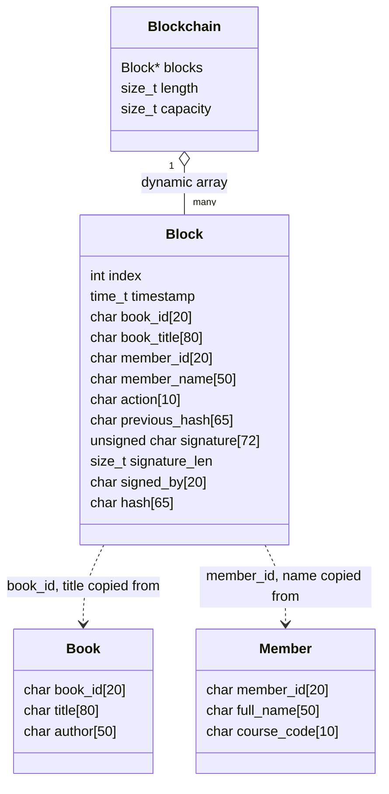
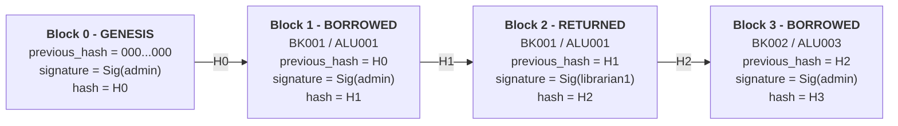
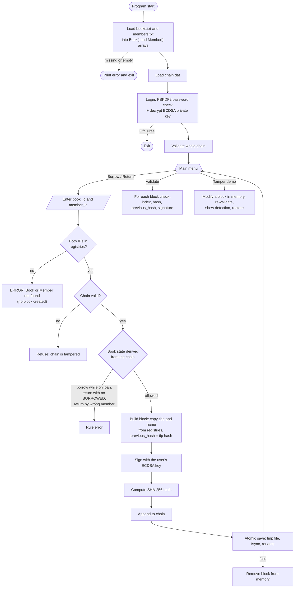
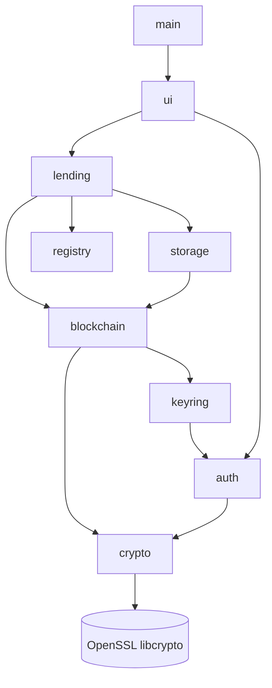

# System Design

This document shows the block structure, how blocks are linked, and how the registries connect
to the lending flow. GitHub renders the diagrams below automatically. PNG versions are in
[`docs/diagrams/`](diagrams/) for use in reports.

## 1. Block structure



## 2. Chain linkage

Each block stores the hash of the block before it. Changing any field of block *n* changes its
hash, so block *n+1*'s `previous_hash` no longer matches. Recomputing the hashes does not help
the attacker, because each block is also signed with the librarian's private key.



How the values are computed:

```
payload   = index|timestamp|book_id|book_title|member_id|member_name|action|previous_hash|signed_by
signature = ECDSA-P256-SHA256(payload, librarian private key)
hash      = SHA-256(payload | hex(signature))
```

## 3. Registry to lending flow



## 4. Module dependencies


