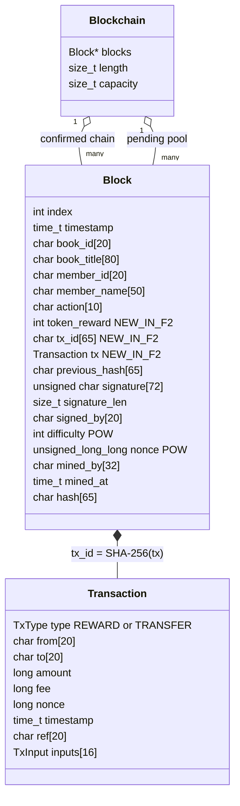
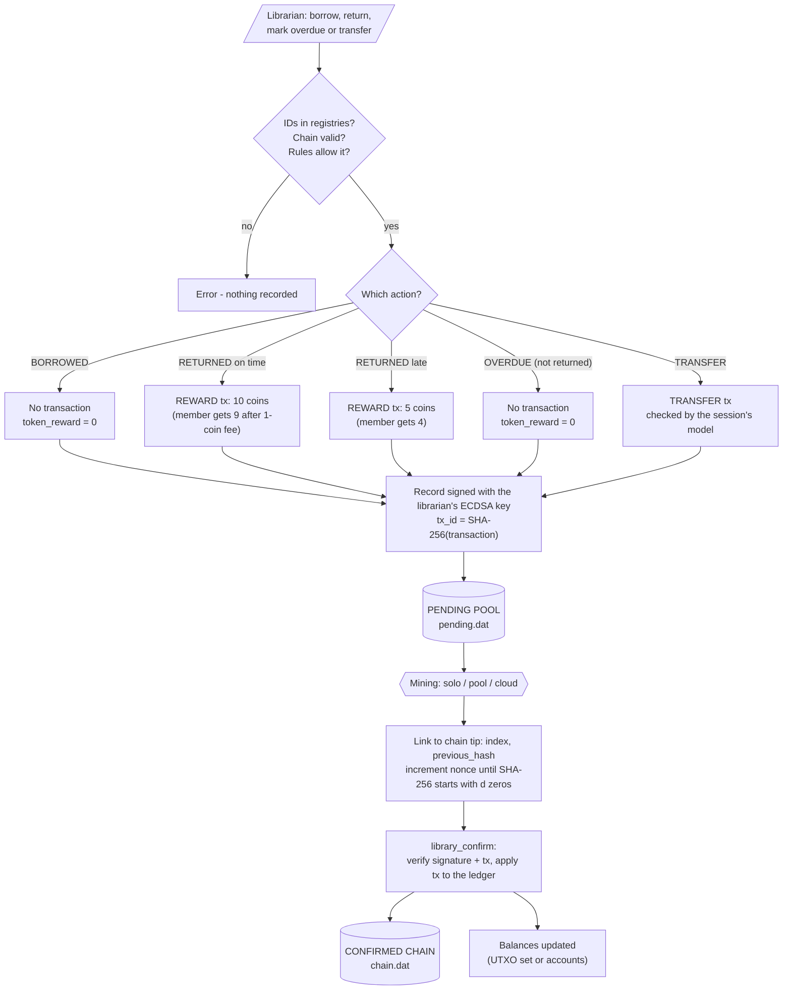
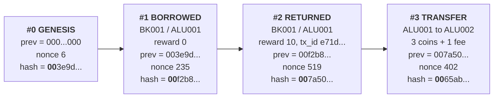
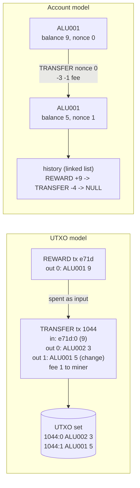
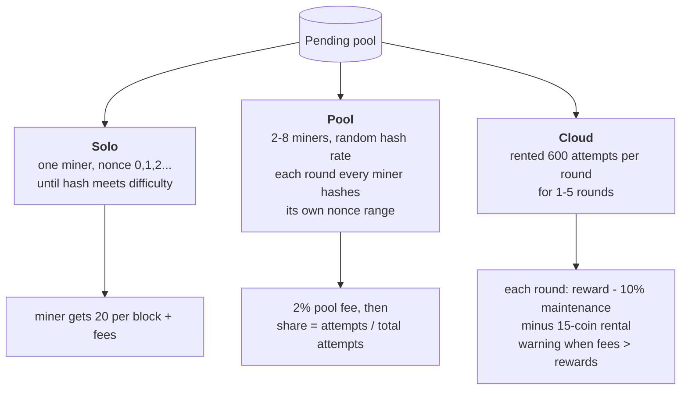
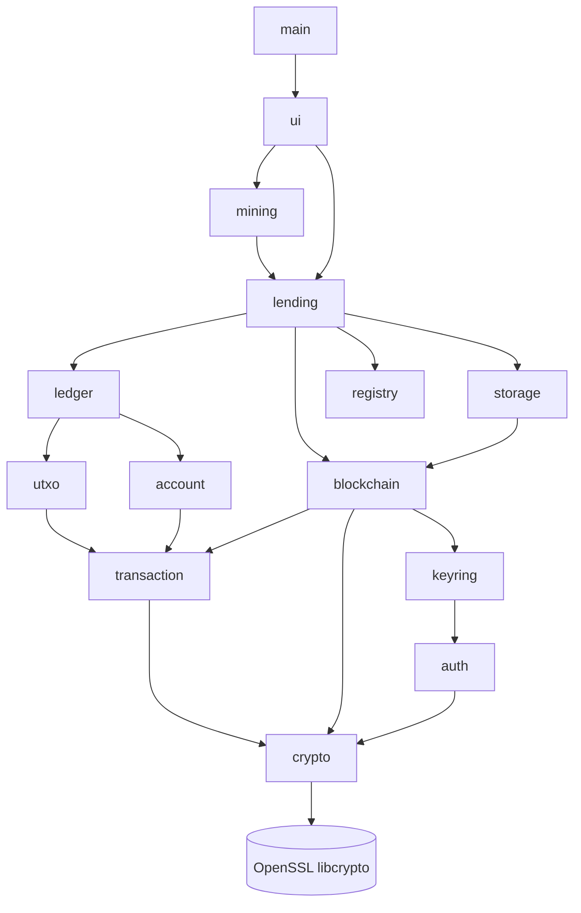

# System Design (v2: tokens and mining)

This document shows how Formative 2 extends the Formative 1 design. Lending actions now create
token transactions, every record waits in a **pending pool**, and mining with **proof-of-work**
is the step that confirms a record and updates the members' balances. GitHub renders the diagrams
below; PNG versions are in [`docs/diagrams/`](diagrams/).

## 1. Block structure

## 2. From lending action to confirmed block

## 3. Chain linkage with proof-of-work

`hash = SHA-256(index | record | signature | previous_hash | difficulty | mined_by | mined_at | nonce)`.
Changing any past block changes its hash, so its proof-of-work and every later link have to be
redone, and its signature fails regardless.

## 4. The two ledger models

## 5. Mining approaches

## 6. Module dependencies

